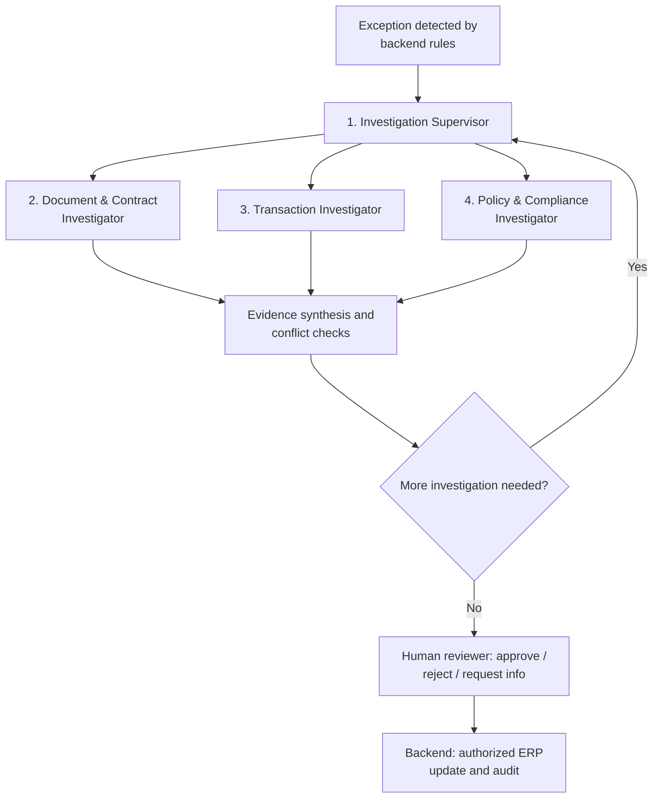

# Vendrai: Vendor-to-Pay Multi-Agent Exception System

## Overview
This repository contains the implementation of the **Vendor-to-Pay Multi-Agent Exception System**.

The system leverages a parallel multi-agent B2B agentic workflow for Procurement and Finance operations. It automates supplier onboarding and invoice exception handling using a stateful LangGraph orchestrator, specialist AI agents, and a strictly enforced human-in-the-loop (HITL) approval mechanism.

## System Architecture

The project is structured as a **modular monorepo** with the following core layers:
- **Web App (`apps/web`)**: Next.js & TypeScript frontend for procurement, finance, approval, and audit interfaces.
- **Core API (`services/api`)**: FastAPI backend for case management, documents, authentication, and structured tool access.
- **Sandboxes (`services/mock_erp`, `services/mock_risk`)**: local ERP and risk-provider stand-ins.
- **Agent Workers (`services/api/app/workers`)**: LangGraph-based workers handling dynamic reasoning, tool calling, specialist agent routing, and verification.
- **Knowledge & Database (`db/`)**: PostgreSQL (with pgvector) as the main relational and hybrid database, paired with Qdrant for policy embeddings.

## Invoice Exception Investigation Flow



## Technical Stack
- **Agent Orchestration:** LangGraph
- **LLM Engine:** Gemini 2.5 Flash API
- **Vector DB:** Qdrant
- **Relational DB:** PostgreSQL (with `pgvector` and `pg_trgm`)
- **Document Processing:** Native PDF parsing, Docling, Tesseract and EasyOCR (all local)
- **Observability:** OpenTelemetry

## Frontend UI Previews

The frontend is built with a modern, high-fidelity Next.js interface optimized for enterprise AP and Procurement teams.

### 1. Active Dashboard & Agent Trace Feed


### 2. Multi-Flow Case Intake Form


### 3. Human Exceptions Approval Queue


### 4. Human-In-The-Loop Document Viewer


### 5. Enterprise Performance Analytics


### 6. Compliance Reports Export


### 7. Global Navigation & Dropdowns


## How to Run the Project

### 1. Prerequisites
- Docker with Docker Compose v2
- Node.js 22.18+
- Python 3.12+
- Git

On Windows, run the commands below from WSL2 (Ubuntu). See the Windows section
in [`docs/RUN_PROJECT.md`](./docs/RUN_PROJECT.md).

### 2. Clone the repository
```bash
git clone https://github.com/Oxshadha/Vendrai.git
cd Vendrai
```

### 3. Create the local environment
```bash
./scripts/bootstrap-local-env.sh
```
This creates the git-ignored `.env` file and generates local service secrets.
Gemini is optional: add `GEMINI_API_KEY` to `.env` to enable it, or leave it
empty to run fully local. Use only synthetic business data.

### 4. Start the full stack
```bash
./scripts/stack.sh product-up
```
This runs a preflight check (Docker, ports, disk, memory, `.env`) and then
builds and starts PostgreSQL, migrations, RabbitMQ, Redis, MinIO, ClamAV,
Keycloak, OPA, Qdrant, local OCR and retrieval, the workers, Mailpit, the mock
ERP, the API and the web app. The first build can take several minutes.

Check progress with:
```bash
./scripts/stack.sh status
```

### 5. Load the reference data
```bash
./scripts/stack.sh bootstrap
```
Loads the vendor master, invoice history, policies and sanctions data through
the API. It is safe to run more than once.

### 6. Check that everything is ready
```bash
./scripts/stack.sh doctor
```
Reports liveness, readiness and business-readiness for the stack.

### 7. Open the application
- Web app: <http://localhost:3000>
- API docs: <http://localhost:8000/docs>
- Keycloak: <http://localhost:8080>
- Mailpit (email inbox): <http://localhost:8025>

### 8. Run the tests (optional)

**Backend:**
```bash
cd services/api
python3.12 -m venv .venv
source .venv/bin/activate
pip install -r requirements-dev.txt
pytest -q
```

**Frontend:**
```bash
cd apps/web
npm ci
npm run lint
npx tsc --noEmit
npm run build
```

### 9. Stop the stack
```bash
./scripts/stack.sh product-down
```

For full setup details per operating system, manual test journeys and
troubleshooting, see [`docs/RUN_PROJECT.md`](./docs/RUN_PROJECT.md).
